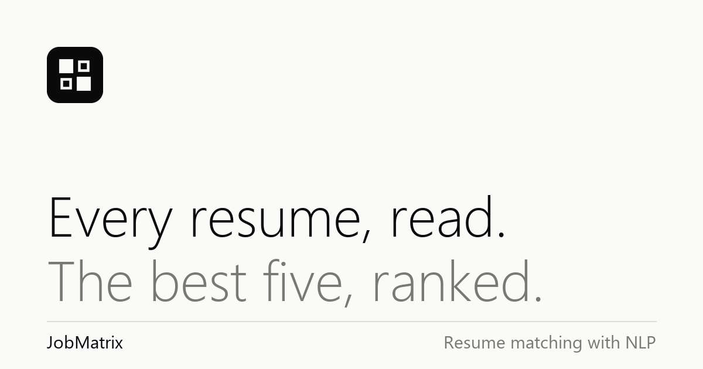

# JobMatrix

**Every resume, read. The best five, ranked.**

JobMatrix compares a job description against any number of resumes and ranks them by how well they fit, using TF-IDF and cosine similarity. Each result shows the job's key terms the candidate matches and the ones they miss.



Built with Flask and scikit-learn. Deployed on [Render](https://render.com).

---

## Features

- **Ranks on content.** TF-IDF weighs the words that matter for the role; cosine similarity scores each resume against it. The top five are shown with a score.
- **Explains every score.** Matched and missing key terms for each candidate.
- **Real files, in bulk.** PDF, DOCX and TXT, up to 50 resumes and 16 MB per run. The job description can be uploaded or pasted.
- **Private by design.** Uploads are processed in memory and never written to disk or stored.
- **Responsive, light and dark mode,** keyboard accessible, WCAG AA contrast.

## How it works

| Step | What happens | Library |
|---|---|---|
| Extract | Text is pulled from each file | `pypdf`, `docx2txt` |
| Clean | Lowercase, tokenise, remove English stop words | scikit-learn |
| Vectorize | Job description and resumes become TF-IDF vectors | `TfidfVectorizer` |
| Compare | Cosine similarity between the job and each resume | `cosine_similarity` |
| Rank | Top five by score, with matched and missing key terms | |

**TF-IDF**

$$\text{tf-idf}(t, d) = \text{tf}(t, d) \times \log\frac{N}{\text{df}(t)}$$

where *t* is a term, *d* a document, *N* the number of documents and df(*t*) the number of documents containing *t*.

**Cosine similarity**

$$\cos\theta = \frac{A \cdot B}{\lVert A \rVert \, \lVert B \rVert}$$

from 0 (nothing in common) to 1 (identical wording). Scores compare wording, so even a strong fit rarely passes 60%. Compare candidates with each other rather than with 100%.

**Limits.** Synonyms aren't matched ("ML" vs "machine learning"), scanned image-only PDFs can't be read, and the score reflects word overlap rather than seniority or quality.

---

## Run locally

Requires Python 3.10 or newer.

```bash
git clone https://github.com/alamdilshad87/JobMatrix_NLP.git
cd JobMatrix_NLP
python -m venv .venv
.venv\Scripts\activate          # Windows
# source .venv/bin/activate     # macOS / Linux
pip install -r requirements.txt
python app.py
```

Open http://localhost:5000. Set `FLASK_DEBUG=1` for auto-reload while developing.

Sample files to try are in [`Resumes_NLP/`](Resumes_NLP): use `JD.txt` as the job description and the rest as resumes.

## Tests

```bash
pip install -r requirements-dev.txt
pytest
```

The suite covers every page, ranking order, error messages, and hostile input: renamed and corrupt files, a DOCX zip bomb, HTML/script injection in file names and contents, path traversal, too many files and oversized uploads.

## Deploy (Render)

- **Build command:** `pip install -r requirements.txt`
- **Start command:** `gunicorn app:app --workers 2 --timeout 60`
- **Environment variables:**

| Variable | Purpose |
|---|---|
| `SECRET_KEY` | Signs the session cookie used for form error messages. Use a long random value. |
| `SESSION_COOKIE_SECURE` | Set to `1` when served over HTTPS. |

## Security

- Uploads are read in memory and never touch the disk.
- File type is checked by extension **and** by content (PDF and DOCX signatures), so renamed files are rejected before parsing.
- Limits on request size (16 MB), number of resumes (50), PDF pages (30), extracted text (100k characters) and decompressed DOCX size (25 MB, zip-bomb guard).
- Strict Content-Security-Policy with no inline scripts, plus `X-Frame-Options`, `X-Content-Type-Options`, `Referrer-Policy`, `Permissions-Policy`, and HSTS over HTTPS.
- Results pages are sent with `Cache-Control: no-store`.
- All output is escaped by Jinja; file names are sanitised.
- Dependencies are pinned and checked with `pip-audit` (no known vulnerabilities at the time of writing).

## Project structure

```
JobMatrix_NLP/
├── app.py                 Flask app: routes, extraction, ranking, security headers
├── template/              Jinja templates (base layout + pages)
├── static/
│   ├── css/style.css      Design system
│   ├── js/                Page scripts (no inline JS)
│   ├── icons/             Logo, favicons, social image
│   └── images/            Team photos
├── tests/                 pytest suite
├── Resumes_NLP/           Sample job description and resumes
├── requirements.txt       Pinned runtime dependencies
└── requirements-dev.txt   Test and audit tools
```

## Roadmap

- Semantic matching with sentence embeddings, so meaning counts and not only exact words
- An evaluation set with precision@k, comparing TF-IDF and embeddings
- OCR for scanned PDFs

## Team

- **Md Dilshad Alam** — Team lead & UI design · [GitHub](https://github.com/alamdilshad87) · [LinkedIn](https://www.linkedin.com/in/alamdilshad87/) · dilshadand@gmail.com
- **Soubhagya Biswas** — Backend · [GitHub](https://github.com/Soub1101) · [LinkedIn](https://www.linkedin.com/in/soubhagya-biswas-a956851ba/)
- **Prachi Singhal** — Data analysis & testing · [GitHub](https://github.com/prachisinghal31/) · [LinkedIn](https://www.linkedin.com/in/prachisinghal31)
